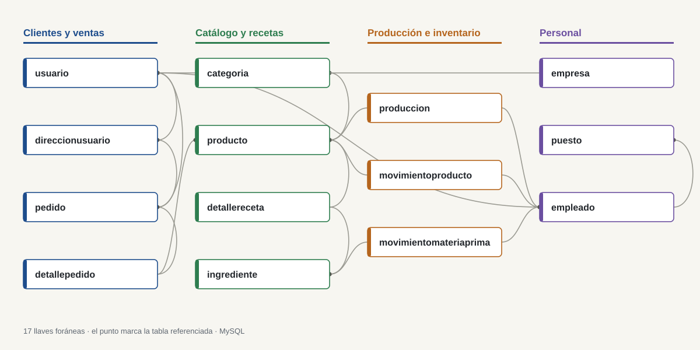

# Tamales Galácticos — Sistema de gestión

Proyecto académico (Universidad Tecmilenio).

 Aplicación de escritorio en **Java (Swing + JDBC)** para administrar un negocio de tamales: productos, costos, precios y ventas.

- `Main.java` — aplicación con interfaz gráfica y acceso a base de datos.
- `sistema_tamales_final.sql` — esquema relacional (14 tablas) con datos de ejemplo.
- `TamalesGalacticos_Costos_y_Precios.xlsx` — modelo de costeo usado para definir precios.

Conceptos aplicados: programación orientada a objetos, modelado relacional, consultas parametrizadas y persistencia.
